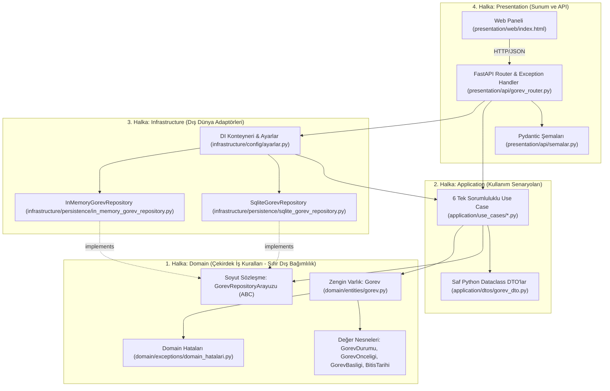
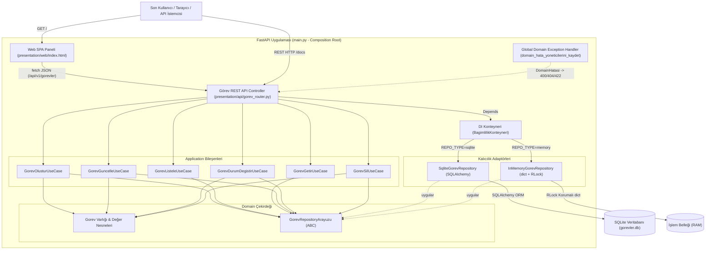
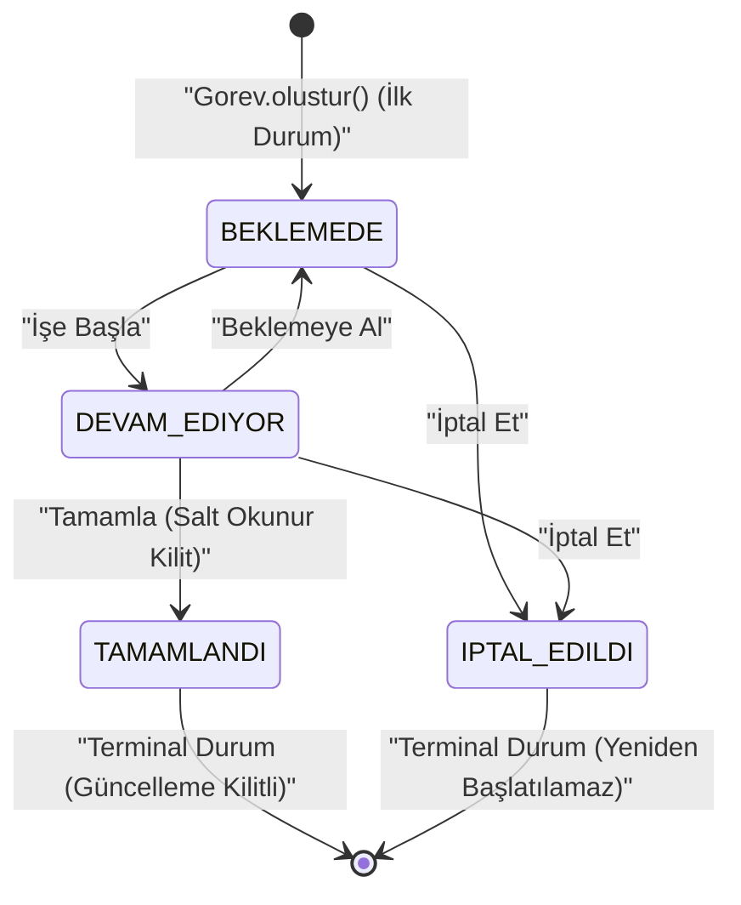

# Mimari Dokümantasyon — Clean Architecture & SOLID

Bu doküman, **Clean Architecture Tabanlı Görev Yönetim Sistemi** projesinin mimari sınırlarını, bağımlılık yönünü, C4 bileşen yapısını, SOLID prensiplerinin kod üzerindeki somut karşılıklarını ve zorunlu Domain iş kurallarını teknik kanıtlarıyla açıklar.

---

## 1. Clean Architecture Katmanları ve Bağımlılık Kuralı

Proje dört eşmerkezli halka üzerine inşa edilmiştir. **Bağımlılık Kuralı (Dependency Rule)** gereği kaynak kod bağımlılıkları yalnızca dış halkadan iç halkaya doğru yönlenir; hiçbir iç katman kendisini çevreleyen dış katmanı, veritabanı sürücüsünü veya web çerçevesini bilmez.

### Katman Sorumluluk Özeti

1. **`domain/` (En İç Halka — Sıfır Dış Bağımlılık):**
   - Yalnızca Python standart kütüphanesi (`abc`, `dataclasses`, `datetime`, `enum`, `typing`, `uuid`) kullanır.
   - `Gorev` zengin domain varlığını, değer nesnelerini (`GorevDurumu`, `GorevOnceligi`, `GorevBasligi`, `BitisTarihi`), iş kuralı istisnalarını ve `GorevRepositoryArayuzu` soyut sözleşmesini barındırır.
   - Bu sınır `tests/architecture/test_bagimlilik_kurallari.py` içindeki AST tarayıcı tarafından otomatik doğrulanır.

2. **`application/` (Kullanım Senaryoları / Orchestration):**
   - İş akışlarını yönetir ve yalnızca `domain/` katmanına bağımlıdır.
   - Framework bağımsız saf `@dataclass(frozen=True)` DTO nesneleri (`GorevOlusturGirdi`, `GorevGuncelleGirdi`, `GorevDurumDegistirGirdi`, `GorevFiltreGirdi`, `GorevCikti`) ile dış dünyadan veri alır ve dış dünyaya veri taşır.
   - Her kullanım senaryosu tek bir iş akışını koordine eder.

3. **`infrastructure/` (Dış Dünya Adaptörleri ve Composition Desteği):**
   - `GorevRepositoryArayuzu` soyut arayüzünü somut olarak uygular:
     - `SqliteGorevRepository` (SQLAlchemy 2.0 + SQLite ORM)
     - `InMemoryGorevRepository` (`RLock` korumalı bellek içi sözlük)
   - `Ayarlar` ve `BagimlilikKonteyneri`, `REPO_TYPE` ortam değişkenine göre uygun adaptörü seçer ve kullanım senaryolarına enjekte eder.

4. **`presentation/` (REST API ve Web Arayüzü):**
   - `FastAPI` yönlendiricileri (`gorev_router`, `sistem_router`), Pydantic istek/yanıt modelleri ve Domain hatalarını HTTP `400 / 404 / 422` kodlarına dönüştüren `domain_hata_yoneticilerini_kaydet` bileşenini içerir.
   - `presentation/web/index.html` dosyası aynı API üzerinden çalışan tek sayfalık modern yönetim panelini sunar.

---

## 2. C4 Bileşen (Component) Diyagramı

Aşağıdaki C4 Seviye-3 Bileşen Diyagramı, çalışma zamanında isteklerin bileşenler arasında nasıl aktığını gösterir:

---

## 3. SOLID Prensipleri Eşleştirme Tablosu (Kanıtlı İnceleme)

| Prensip | Proje Dosyası ve Satır Aralığı | Sınıf / Fonksiyon | Somut Uygulama Kanıtı |
| :--- | :--- | :--- | :--- |
| **S — Single Responsibility Principle (Tek Sorumluluk)** | [gorev_olustur.py](file:///c:/Users/omer/Desktop/model/yazilim/application/use_cases/gorev_olustur.py), [gorev_listele.py](file:///c:/Users/omer/Desktop/model/yazilim/application/use_cases/gorev_listele.py), [gorev_getir.py](file:///c:/Users/omer/Desktop/model/yazilim/application/use_cases/gorev_getir.py), [gorev_guncelle.py](file:///c:/Users/omer/Desktop/model/yazilim/application/use_cases/gorev_guncelle.py), [gorev_durum_degistir.py](file:///c:/Users/omer/Desktop/model/yazilim/application/use_cases/gorev_durum_degistir.py), [gorev_sil.py](file:///c:/Users/omer/Desktop/model/yazilim/application/use_cases/gorev_sil.py); [tarih_dogrulama.py](file:///c:/Users/omer/Desktop/model/yazilim/domain/value_objects/tarih_dogrulama.py#L31-L89) | 6 adet `*UseCase` sınıfı; `GorevBasligi`, `BitisTarihi` | Her Use Case sınıfı tek bir `calistir()` metoduyla yalnızca tek bir uygulama senaryosunu koordine eder. Başlık uzunluk/trim doğrulaması `GorevBasligi` içinde, tarih/UTC doğrulaması `BitisTarihi` içinde, HTTP hata eşlemesi ise yalnızca `domain_hata_yoneticilerini_kaydet` içinde izole edilmiştir. |
| **O — Open/Closed Principle (Açık/Kapalı)** | [ayarlar.py](file:///c:/Users/omer/Desktop/model/yazilim/infrastructure/config/ayarlar.py#L82-L87), [gorev_router.py](file:///c:/Users/omer/Desktop/model/yazilim/presentation/api/gorev_router.py#L43-L50) | `BagimlilikKonteyneri._repository_olustur`, `_DOMAIN_HTTP_ESLEMESI` | Sisteme yeni bir veritabanı adaptörü (örneğin PostgreSQL veya MongoDB) eklendiğinde `GorevRepositoryArayuzu` uygulanır; mevcut `domain/`, `application/` ve `presentation/api/` kodları değiştirilmeden yalnızca fabrika seçimi genişletilir. Benzer şekilde yeni bir `DomainHatasi` alt sınıfı eklendiğinde `_DOMAIN_HTTP_ESLEMESI` tablosuna bir kayıt eklemek yeterlidir. |
| **L — Liskov Substitution Principle (Liskov Yerine Geçebilirlik)** | [gorev_repository_arayuzu.py](file:///c:/Users/omer/Desktop/model/yazilim/domain/repositories/gorev_repository_arayuzu.py#L13-L39), [in_memory_gorev_repository.py](file:///c:/Users/omer/Desktop/model/yazilim/infrastructure/persistence/in_memory_gorev_repository.py#L15-L75), [sqlite_gorev_repository.py](file:///c:/Users/omer/Desktop/model/yazilim/infrastructure/persistence/sqlite_gorev_repository.py#L47-L185) | `InMemoryGorevRepository`, `SqliteGorevRepository` | Her iki depo implementasyonu da `GorevRepositoryArayuzu` sözleşmesinin ön/son koşullarını birebir korur: olmayan kayıtta `id_ile_getir` her ikisinde de `None` döner, `guncelle` ikisinde de `GorevBulunamadiHatasi` fırlatır, `tumunu_listele` ikisinde de UTC normalize tarihlerle azalan sıralı ve Türkçe `.casefold()` aramalı liste döner. `tests/integration/` testleri aynı senaryoları iki implementasyonla yer değiştirerek geçirir. |
| **I — Interface Segregation Principle (Arayüz Ayrımı)** | [gorev_repository_arayuzu.py](file:///c:/Users/omer/Desktop/model/yazilim/domain/repositories/gorev_repository_arayuzu.py#L13-L39), [gorev_dto.py](file:///c:/Users/omer/Desktop/model/yazilim/application/dtos/gorev_dto.py#L14-L50) | `GorevRepositoryArayuzu`, `GorevOlusturGirdi`, `GorevGuncelleGirdi`, `GorevDurumDegistirGirdi`, `GorevFiltreGirdi` | Depo sözleşmesi gereksiz altyapı metotları (`session_ac`, `commit`, `temizle`, `kapat`) içermez; yalnızca Domain'in gereksinim duyduğu 5 veri erişim metodunu tanımlar. Ayrıca her Use Case yalnızca kendi ihtiyacı olan ayrıştırılmış girdi DTO'sunu alır; monolitik tek bir istek nesnesine zorlanmaz. |
| **D — Dependency Inversion Principle (Bağımlılıkların Tersine Çevrilmesi)** | [gorev_repository_arayuzu.py](file:///c:/Users/omer/Desktop/model/yazilim/domain/repositories/gorev_repository_arayuzu.py#L13), [gorev_olustur.py](file:///c:/Users/omer/Desktop/model/yazilim/application/use_cases/gorev_olustur.py#L13-L14), [ayarlar.py](file:///c:/Users/omer/Desktop/model/yazilim/infrastructure/config/ayarlar.py#L62-L126) | `GorevRepositoryArayuzu`, Use Case `__init__`, `BagimlilikKonteyneri` | Yüksek seviye `application` katmanı Use Case sınıfları, düşük seviye `SqliteGorevRepository` veya `InMemoryGorevRepository` sınıflarını değil, `domain` katmanında tanımlı `GorevRepositoryArayuzu` soyutlamasını parametre alır. Somut adaptör seçimi ve bağlanması en dışta `BagimlilikKonteyneri` ve `main.py` üzerinden yapılır. |

---

## 4. Zorunlu İş Kuralları ve HTTP Eşlemesi

Tüm iş kuralları Presentation veya veritabanı katmanına sızdırılmadan doğrudan Domain katmanında zorunlu kılınır:

| # | İş Kuralı | Uygulandığı Domain Noktası | Fırlatılan Hata (`hata_kodu`) | HTTP Durumu |
| :---: | :--- | :--- | :--- | :---: |
| **1** | Geçmiş `bitis_tarihi` ile görev oluşturulamaz ve güncellenemez | `BitisTarihi.olustur` (`tarih_dogrulama.py:64-84`), `Gorev.olustur`, `Gorev.guncelle` | `GecmisTarihHatasi` (`GECMIS_TARIH`) | `422` |
| **2** | `BEKLEMEDE` → `TAMAMLANDI` doğrudan yasak; `IPTAL_EDILDI` yeniden başlatılamaz | `GorevDurumu._IZINLI_GECISLER` (`gorev_durumu.py:25-38`), `Gorev.durum_degistir` (`gorev.py:189-232`) | `GecersizDurumGecisiHatasi` (`GECERSIZ_DURUM_GECISI`) | `400` |
| **3** | `TAMAMLANDI` durumundaki görev salt okunurdur, güncellenemez | `Gorev.guncelle` (`gorev.py:162-166`) | `KilitliGorevHatasi` (`KILITLI_GOREV`) | `400` |
| **4** | `KRITIK` öncelikli ve `DEVAM_EDIYOR` durumundaki görev doğrudan silinemez | `Gorev.silinebilir_mi_dogrula` (`gorev.py:234-243`) | `KritikGorevSilinemezHatasi` (`KRITIK_GOREV_SILINEMEZ`) | `400` |
| **5** | Başlık boş olamaz; kırpıldıktan sonra 3–100 karakter olmalıdır | `GorevBasligi.__post_init__` (`tarih_dogrulama.py:40-55`) | `GecersizBaslikHatasi` (`GECERSIZ_BASLIK`) | `422` |
| **—** | İstenen görev kimliği depoda bulunamazsa | `GorevGetir/Guncelle/DurumDegistir/SilUseCase` | `GorevBulunamadiHatasi` (`GOREV_BULUNAMADI`) | `404` |

---

## 5. Görev Durum Makinesi Diyagramı (State Diagram)

> **Not:** `BEKLEMEDE` durumundan `TAMAMLANDI` durumuna doğrudan ok bulunmamaktadır. Bu geçiş denendiğinde Domain katmanı `GecersizDurumGecisiHatasi` fırlatır ve API katmanı HTTP `400` yanıtı döner.
